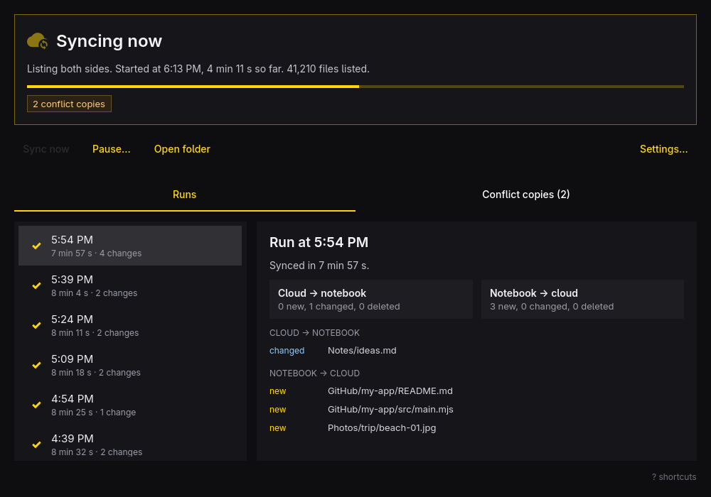
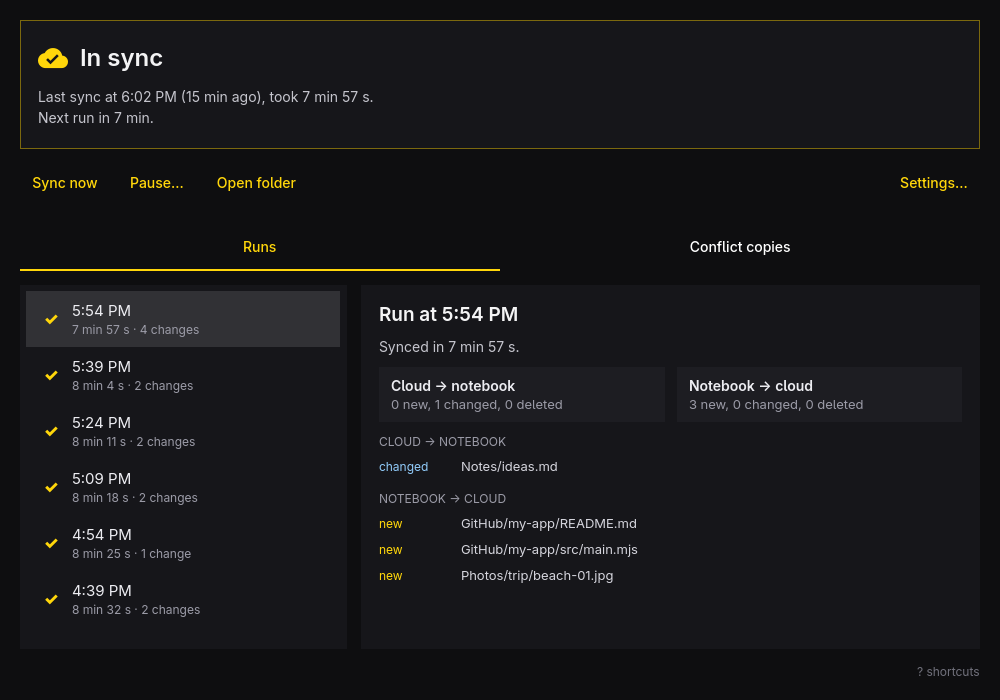
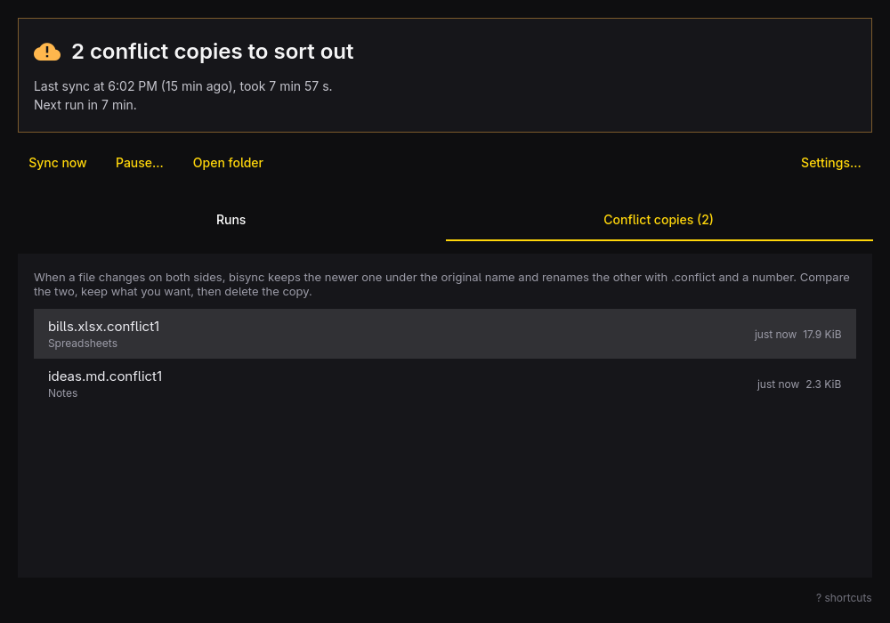
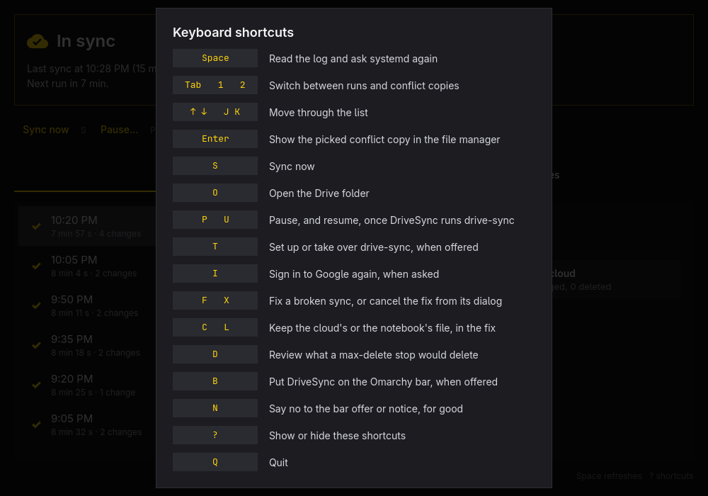

[](https://www.qt.io/) [](https://isocpp.org/) [](https://doc.qt.io/qt-6/qtquick-index.html) [](https://omarchy.org/) [](https://archlinux.org/) [](https://rclone.org/bisync/) [](https://www.google.com/drive/) [](LICENSE)

# ☁️ DriveSync

DriveSync is an Omarchy app that shows how `drive-sync` is doing: the rclone
bisync that mirrors `~/Drive` with Google Drive every 15 minutes. One window
and a bar widget, driven from the keyboard.

<p align="center">
  
</p>

- **Status**: in sync, syncing now (with the phase and a progress bar against
  the usual run time), resync in progress, failed (with the same cause the
  desktop notification names and how to recover), cut off, timer off, late
  (no success in three sync intervals: 45 minutes at the usual 15), or a fix
  at work or waiting for you.
- **Runs**: the last 40 runs from the log, each with what changed in the
  cloud and on the notebook, file by file, and its errors.
- **Conflict copies**: the `*.conflictN` files bisync left in `~/Drive` when a
  file changed on both sides, newest first, one key away from the file manager.
- **Bar widget**: a cloud on the Omarchy bar with the same state as the
  window (a check when in sync, arrows while syncing, a clock while paused,
  an alert on trouble), and a panel with the last sync, the next run and what
  failed.
- **Controls**: sync now; once DriveSync runs drive-sync, pause for an hour,
  until the next 8:00 or until you resume. A pause survives a reboot.
- **Notifications**: a card when a run fails, a reminder every hour while it
  keeps failing, and a note once it works again; an hourly check for a timer
  that is off; a daily reminder of a pause with no end.
- **First setup**: with no drive-sync at all, signs in to Google in the
  browser, takes the folder you pick and starts the sync after a dry run you
  confirm; when Google later drops the sign-in, `I` signs in again.
- **Takeover**: runs an existing drive-sync from DriveSync's own units with
  the same rclone command, so no resync is needed (going back is by hand
  once DriveSync keeps its accounts under `accounts/`).
- **Fix**: rebuilds the base of both sides after lost listings, listings out
  of sync or edited filters, with `~/Drive` still in use, asking you about
  every file that changed in the cloud meanwhile.
- **Settings** (`,`): the sync interval and the max-delete guard, at once;
  the local folder, the filters and which cloud folders come down to this
  computer (selective sync), through a fix whose dry run you confirm.

It starts a resync only as a fix you confirmed, and touches no synced file
otherwise. It writes its own state in `~/.local/state/drive-sync-app/`, the link
to its bar widget and, when you accept, the bar layout through
`omarchy plugin`. After a takeover or a first setup it also owns
`~/.config/drive-sync/` and the account's user timer
(`drive-sync@account1.timer`), and a first setup adds the `drive-sync` remote
to `rclone.conf` through rclone itself. A sync interval other than 15
minutes, set in Settings, is written as
`~/.config/systemd/user/drive-sync@account1.timer.d/drive-sync-interval.conf`
(`drive-sync.timer.d/` for the single config of older versions, until the
move below), which an interval of 15 minutes removes.

DriveSync keeps everything per account: each one has its config in
`~/.config/drive-sync/accounts/<id>/` (`account1` for now), its state in
`~/.local/state/drive-sync-app/accounts/<id>/` and its own units
(`drive-sync@<id>.service`, `.timer` and `drive-sync-fix@<id>.service`).
A drive-sync set up by an older version, with its single
`~/.config/drive-sync/config.json`, becomes `account1` with no resync: the
window when it opens, the hourly watchdog or `drive-sync accounts --migrate`
move the config byte for byte, the pause, fix and card state, the interval
drop-in and the `runOnlyWhen` check (to `~/.config/drive-sync/machine.json`,
which holds every account's runs), then swap `drive-sync.timer` for
`drive-sync@account1.timer`. The folder, remote, work dir, filters and log
stay where they are. The move waits, touching nothing, while a run, a fix
step or a takeover is going, and any failure is undone from its journal
(`~/.local/state/drive-sync-app/migration.json`). Nothing looks different
afterwards.

## Screens

| Run details                                                                                                         | Conflict copies                                                                                                                   |
| ------------------------------------------------------------------------------------------------------------------- | --------------------------------------------------------------------------------------------------------------------------------- |
|  |  |

> [!NOTE]
> The window pictures are the real app drawn offscreen over a made-up log
> (`bin/harness`), under another Omarchy theme. The bar pictures come from a
> real machine and show no file names. No real files or names appear in this
> repository.

## Shortcuts

The window shows no keys beside its buttons: `?` lists them all, and a
button names its key when the pointer rests on it.

| Key              | Action                                                          |
| ---------------- | --------------------------------------------------------------- |
| `Space`          | Read the log and ask systemd again                              |
| `Tab`, `1`, `2`  | Switch between runs and conflict copies                         |
| `↑` `↓`, `J` `K` | Move through the list                                           |
| `Enter`          | Show the picked conflict copy in the file manager               |
| `S`              | Sync now                                                        |
| `O`              | Open the Drive folder                                           |
| `P`              | Pause for 1 hour, until 8:00 or until resumed                   |
| `U`              | Resume, and start a run                                         |
| `T`              | Set up drive-sync, or take over the one you have, when offered  |
| `I`              | Sign in to Google again, when Google no longer accepts it       |
| `F`, `X`         | Fix a broken sync, or cancel the fix in its dialog              |
| `C`, `L`         | Keep the cloud's or the notebook's file, in the fix's questions |
| `D`              | Review what a max-delete stop would delete                      |
| `,`              | Settings: folder, interval, guard, cloud folders, filters       |
| `Ctrl+1` `2` `3` | In Settings: General, Cloud folders, Filters                    |
| `Ctrl+S`         | In Settings: save the page shown and close                      |
| `Ctrl+E`         | In first setup: choose what does not sync                       |
| `Enter`, `Esc`   | In a dialog: confirm, or close it                               |
| `B`              | Put DriveSync on the Omarchy bar, when offered                  |
| `N`              | Say no to that offer, or hide its notice for good               |
| `?`              | Show or hide the shortcuts                                      |
| `Q`              | Quit                                                            |

<p align="center">
  
</p>

## What it reads

| Source                                                      | For                                                          |
| ----------------------------------------------------------- | ------------------------------------------------------------ |
| The log the config names (`~/.local/state/drive-sync.log` after a takeover) | Runs, changes, errors (the last 3 MB)            |
| `systemctl --user show drive-sync@account1.service drive-sync@account1.timer drive-sync-fix@account1.service` | Running, last result, timer on and enabled, the fix's unit |
| `systemctl --user list-timers drive-sync@account1.timer`    | Next run                                                     |
| `~/.local/state/drive-sync/pausado`                         | A resync from `drive-sync.sh` that paused the timer          |
| `~/.config/drive-sync/accounts/<id>/config.json`            | The rclone command of each account DriveSync runs            |
| `~/.config/drive-sync/machine.json`                         | The `runOnlyWhen` check that holds every account's runs on the wrong home |
| `~/.local/state/drive-sync-app/accounts/<id>/paused.json`   | A pause, and when it ends                                    |
| `~/.local/state/drive-sync-app/accounts/<id>/fix.json`      | A fix: its step, the dry run's count and its questions       |
| `find ~/Drive -name '*.conflict[0-9]*'`                     | Conflict copies (`.git`, `node_modules` and `.venv` skipped) |
| `rclone listremotes`, `rclone config dump`                  | Sign-in only: whether the `drive-sync` remote exists and holds a token, read in memory and never shown |
| `rclone lsjson <remote>:<folder> --dirs-only`               | Settings and first setup only: one level of the cloud's folders, nothing copied |

The log is watched, systemd is polled every 30 seconds (5 while a run is
going), and conflict copies are looked for again every 2 minutes and after
each run. The count of conflict copies is kept in
`~/.local/state/drive-sync-app/accounts/<id>/conflicts.json`, so the bar does not walk `~/Drive`
every few seconds.

## Bar widget

<p align="center">
  
  
</p>

The package installs the widget under `/usr/share/drive-sync/omarchy-plugin`.
Omarchy only loads plugins from `~/.config/omarchy/plugins`, so the first time
the window opens it links the widget there and offers to put it on the bar
(`B`). If an older drive-sync widget is on the bar, DriveSync offers to take
its place. Nothing changes on the bar without that key or button, and the
bar's layout is only changed through `omarchy plugin`. `N` says no, and the
offer does not come back; delete `~/.local/state/drive-sync-app/bar-declined` to
be asked again. After a package upgrade, `omarchy restart shell` loads the new
widget. In its panel, `S` syncs now, `P` pauses for an hour or resumes, and
`?` lists every key; hovering an icon says what it does.

The widget reads `drive-sync status --json` (version 2), so it shows what
the window shows, for the account that needs you most: an account whose
`config.json` cannot be read is an error of its own ("This account's
DriveSync config cannot be read", `configError`), and an old drive-sync
found next to DriveSync's accounts is a line in the panel.

## First setup

With no drive-sync at all, the window offers to set one up (`T`). The
dialog goes through five steps, and nothing is copied before the last one:

1. **Sign in to Google.** Your browser opens Google's sign-in page for
   DriveSync, through rclone's own flow (`rclone config create`): the token
   goes from Google into `rclone.conf` and never through DriveSync. The new
   rclone remote is called `drive-sync`. If the browser does not open, the
   dialog shows the local address to open by hand. Closing the dialog or the
   window while the browser waits (or Ctrl+C on `drive-sync signin`) stops
   rclone alone, never the browser, and removes the half-made remote. A
   `drive-sync` remote DriveSync made earlier is used again (signed in again
   when its token no longer works); one you made yourself is never touched.
2. **Choose the folder,** `~/Drive` by default. Files already in it stay and
   go to the cloud; where both sides have a file at the same path, the newer
   copy wins on both, and the dry run lists every copy.
3. **Choose the cloud folders.** A tree of the cloud's folders, read a level
   at a time; untick what should stay only in the cloud (`Tab` reaches the
   list, `Space` ticks, `→` opens a folder). Settings change it later.
4. **Choose what does not sync** (`Ctrl+E` opens and closes the editor): the
   same screen as the Filters page of Settings, below. A folder that already
   holds builds, virtual environments or links needs its rules before the
   first base run. rclone checks every rule when you start, before anything
   is written.
5. **Start.** The new drive-sync is DriveSync's first account, `account1`.
   DriveSync writes the filters (the defaults or the imported ones) to
   `~/.config/drive-sync/accounts/account1/filters.txt` (the defaults: `.git`,
   `node_modules`, `.venv`, Python caches, Google Docs shortcuts and system
   junk) and its config beside them, keeps the work dir and the log in
   `~/.local/state/drive-sync-app/accounts/account1/`, and starts a fix (see
   below): a dry run lists every copy in both directions, and the base run
   waits for your confirmation. `drive-sync@account1.timer` and the watchdog
   come on at the same time, but every tick waits until the fix ends.

Setup needs rclone 1.66 or newer, and refuses when a drive-sync already
exists (take it over instead), when DriveSync already has an account, when
the folder is the home folder or holds or sits inside `~/.config`,
`~/.local/state` or the folders of DriveSync and rclone, or when
`~/.config/drive-sync/filters.txt` (the single filters file of older
versions) already exists.

Cancelling that first fix (`X`) before its base run undoes the setup: the
timers go off, the config and the filters it wrote go with the account's
config folder, and the window offers setup again, so another folder can be
picked. A run refused because no first
sync was ever confirmed says so ("press F"), never that the filters changed.

The Google client DriveSync signs in with is compiled in from
`src/oauthclient.local.h`, which is not in the repository; a build without it
says "this build has no Google client" (see `src/oauthclient.local.h.example`).

### Signing in again

When Google no longer accepts the token (it expired, or the access was
revoked in the Google account), every run fails with the cause "sign in
again" in the window, the card and the bar, never rclone's own advice, which
needs a terminal. `I` opens the browser sign-in again for the remote the
config uses, with that remote's own client (a taken-over setup keeps the one
it was made with), and then starts a run. A fix that stopped on the token
says the same: sign in again (`I`), then retry it (`F`). A network failure
while fetching the token is an ordinary error, not a sign-in.

## Settings

`,` opens Settings once DriveSync runs drive-sync. `Ctrl+1`, `Ctrl+2` and
`Ctrl+3` pick a page, `Ctrl+S` (or Save) saves the page shown and closes,
`Esc` closes without saving. Save stays open only when another page still
has unsaved edits, and says so. Every
change goes through `drive-sync settings`, so the window writes nothing itself.

- **Sync interval**, from 5 minutes to 4 hours in the window (5 to 1440 on
  the command line), applies at once: DriveSync keeps it in its config and
  writes it into a drop-in for the account's packaged timer,
  `~/.config/systemd/user/drive-sync@account1.timer.d/drive-sync-interval.conf`
  (none at the usual 15 minutes; `drive-sync.timer.d/` for the single config
  of older versions until it moves to `account1`). "Late" follows it: three intervals with no
  successful run.
- **Max-delete guard**, 1% to 50%, applies at once. After a run stopped at
  the guard it can only go down: those deletions go through `D`.
- **Local folder.** A new folder means a new base: the fix makes a dry run
  from the cloud and whatever the new folder holds, and nothing is copied
  before you confirm it. The old folder stays as it is, outside the sync. A
  folder inside the current one, or holding it, is refused.
- **Cloud folders** (selective sync): the tree of the cloud's folders, read
  with `rclone lsjson --dirs-only` a level at a time (`↑` `↓` `J` `K` move,
  `Space` ticks, `→` `←` open and close). An unticked folder stays whole in
  the cloud; one that was synced keeps its copy on this computer, outside the
  sync, and the window names it, since deleting it is your call. A folder
  ticked again sends its local copy back up, files deleted in the cloud
  meanwhile included, and the window says so before saving. The ticks become
  a block of rules at the top of the filters file, between
  `# BEGIN DriveSync: cloud folders left out of this computer` and its
  `# END` line.
- **Filters**: what does not sync, built on screen, in four parts:
  - **Ready-made groups** to tick: Git folders, `node_modules`, Python
    environments and caches, build output, Google Docs shortcuts, Windows
    and macOS junk, locks and temporary files.
  - **On this computer**: the synced folder as a tree; untick a folder or a
    file to leave it out. A link shows a warning: rclone never syncs a link,
    so a cloud file with its name would come down over it unless it is
    unticked.
  - **By name**: a name, a folder, an extension or a path, each shown as a
    sentence ("No folder named build, in any folder").
  - **Advanced**: every other rclone rule, kept as written and read before
    the parts above, so a `+` rule there wins. A filters file from an
    earlier sync can be imported here; what the screen can show lights up.

  Each of the first three parts is a marked block at the end of the filters
  file (`# BEGIN DriveSync: ready-made groups`, `paths on this computer`,
  `rules by name`); everything else stays as written. Saving checks the
  rules with rclone first.

The folder, the cloud folders and the filters change what bisync compares,
so saving them starts a fix: its dry run waits for your confirmation, and
runs wait until it ends. Cancelling that fix (`X`) before its base run puts
the old config and filters back byte for byte, and the sync goes on with its
old base. Saving bytes that did not change starts nothing. The new config
and filters are written by the fix itself, once no run is under way, never
under a run that already started. After a folder change, undoing the takeover
is refused until the folder is set back.

## Taking over drive-sync

When the window finds a drive-sync made by `drive-sync.sh`, it offers to run
it from DriveSync (`T`), showing first what moves. Nothing is offered while a
run is going, after a run that failed, or when the old units have anything
DriveSync cannot keep: the window names what stops it. When the only thing in
the way is a run, `T` arms the offer, and the dialog opens by itself once the
run ends (`T` again cancels). A run that starts while the dialog is open does
not undo the confirmation: the takeover waits for it and then happens by
itself, and `T` cancels the wait.

- The drive-sync becomes DriveSync's first account, `account1`: the packaged
  `drive-sync@account1.service` and `.timer` run it instead of the old units,
  and `drive-sync-watchdog.timer` replaces `drive-sync-vigia.timer`.
- The same remote, folder, work dir, log and rclone flags go to
  `~/.config/drive-sync/accounts/account1/config.json`. The filters move with
  their `.md5` to `~/.config/drive-sync/accounts/account1/filters.txt`, byte for
  byte, so bisync keeps its base. The old unit's `ExecCondition` (run only on
  the right home) goes to `~/.config/drive-sync/machine.json`, which guards
  every account on the machine.
- The old units, `drive-sync.sh`, `drive-sync-aviso`, the filters and the old
  state move to `~/.local/share/drive-sync/taken-over/<date>/`, with a manifest.
  Nothing is deleted. If any step fails, every step done so far is undone,
  except when an old file cannot move back: then every drive-sync timer is
  left off, the error names the file, and the manifest says where each one is.
- `drive-sync takeover --undo` goes back only from a takeover made before
  accounts (the single `~/.config/drive-sync/config.json`), unless a fix is
  under way. Once DriveSync keeps its accounts under `accounts/`, it refuses
  and touches nothing: going back to `drive-sync.sh` is done by hand, following
  the backup's `manifest.json`.

`drive-sync run` refuses to start rclone when the filters' `.md5` is missing or
stale: a single bisync run in that state throws away its base, and only a
resync brings it back. So filters change in two steps: edit the filters file
the config names (`filtersFile`: `~/.config/drive-sync/accounts/account1/filters.txt`
after a takeover or a first setup, `~/.config/drive-sync/filters.txt` for a
drive-sync taken over by an older version, which the move to `account1`
leaves where it is), then press `F`; or edit them in Settings, which does
both.

## Fixing a broken sync

When bisync loses its listings, finds them out of sync, or the filters
changed, every run fails until the base of both sides is rebuilt. Once
DriveSync runs drive-sync, the window offers the fix (`F`, or any time from
`F`), and it runs in its own unit, `drive-sync-fix@account1.service`, so closing the
window or logging out does not stop it halfway:

1. Every run waits from the first step to the last: timer ticks, `S`, `U`
   and the bar's sync are skipped while `fix.json` exists.
2. A dry run lists what the base run would copy, each copy with its
   direction and the ones to the notebook first (a file you deleted there
   would come back among them), and nothing changes until you confirm it
   (`Enter`; `X` cancels the fix).
3. The base run, a resync where the newer file wins, takes about 40 minutes
   with `~/Drive` still in use.
4. The two new listings are compared. A file that changed on the notebook
   during the base run is kept without asking. A file that changed in the
   cloud, or appeared only there, is asked about: `C` keeps the cloud's
   version, `L` the notebook's (a file only in the cloud goes to the Drive
   trash).
5. A normal run checks that both sides match, and the timer runs again.

A fix waiting for you, or one that stopped, sends a card at once and every
hour after. A step that stopped (a logout without lingering, a shutdown) is
retried with `F`; a lock the stopped run left expires after 2 minutes, and the
retry waits it out. Once the base ran, `X` asks twice: cancelling throws that
run away, and every run fails until another fix.

No fix is offered where the `runOnlyWhen` check (`~/.config/drive-sync/machine.json`)
says no (another home mounted), nor after `--max-delete` stopped a run: a resync would bring the
deleted files back. That holds when the filters were edited after the stop
too: undo the edit first, so the next run shows the deletions under `D`.

## When too many files would be deleted

bisync's `--max-delete` guard (5% in drive-sync's config) stops a run that
would delete more than that share of one side, before it deletes anything.
The run's log lists every file it would have deleted, and DriveSync shows
that list instead of a fix:

1. The headline counts the files, the card says "press D", and the bar names
   the cause. Nothing syncs until it is answered.
2. `D` opens the list, split by side. A file gone from the cloud would be
   deleted on the notebook: those come first, marked `↓`, and the run you
   let through moves them to
   `~/.local/state/drive-sync-app/accounts/account1/allowed-backup/<time of the stop>` instead
   (with any notebook file it overwrites). A file gone from the notebook
   would go to the Drive trash (`↑`). The window shows the first 500;
   `drive-sync deletes --list` prints all of them. That folder is never
   emptied by DriveSync: delete it once you are sure.
3. To let them through, type how many files the list has and press `Enter`.
   One run starts with the guard raised just enough for them, never
   `--force`; the run after it has the guard again.
4. That run first does a dry run with the raised guard. When it finds a
   deletion that was not in the list you confirmed (a file deleted
   meanwhile), or the stopped run is no longer the last one, it keeps the
   usual guard, stops again, and `D` shows the new list. The run's own
   listing, a minute after the dry run, still has one raised guard for both
   sides: confirming 1,800 deletions out of 33,000 lets either side lose up to
   6% in that listing. Each side's guard is counted against that side's own
   listing, as bisync checks it.
5. After that run, DriveSync compares what it deleted with the list you
   confirmed. Anything more is written to the log, named on a card and in the
   window, with where it went: the backup folder above for the notebook, the
   Drive trash for the cloud.

The confirmation lasts for one run and expires after 30 minutes, in case the
run never started (a pause set right after it). When the files should not go,
restore them in `~/Drive` (or from the Drive trash) and sync again.

## Command line

```sh
drive-sync                 # the window (also: drive-sync open)
drive-sync status           # one line: the status and any warnings
drive-sync status --json    # the same state as JSON, for the bar and scripts
drive-sync sync             # one run now
drive-sync pause [--minutes N | --until-tomorrow]   # no flag: until resumed
drive-sync resume           # end the pause and start a run
drive-sync signin           # sign in to Google in the browser (first setup, or again)
drive-sync signin --abandon # remove a drive-sync remote whose sign-in never finished
drive-sync setup --folder <path> [--skip <cloud folder>]... [--filters <file>|-]   # first setup, after signin; --filters imports an earlier sync's rules
drive-sync settings         # the settings; with one change: --interval N | --max-delete N |
                            # --folder <path> | --filters <file> (- reads stdin) | --skip <cloud folder>... | --skip-none
drive-sync folders [--remote <remote:>] [[--] <cloud folder>]   # one level of the cloud's folders
drive-sync takeover --check | --apply | --undo
drive-sync fix --start | --confirm | --answers <file.json> | --cancel | --retry
drive-sync deletes --list | --allow <count>   # after a max-delete stop
drive-sync accounts [--json]                  # the mode, the accounts, and whether the move to account1 can go
drive-sync accounts --migrate                 # make that move now (the window and the watchdog also do)
```

Every command but `setup`, `takeover`, `watchdog` and `accounts` takes
`--account <id>` (`account1`...) as its first two arguments:
`drive-sync settings --account account1 --interval 30`. Without it,
`status`, `sync`, `pause` and `resume` act on every account, and the others
on the only one (with several they ask for `--account`). With one account,
`status` prints the same line as before; with several, one
`<id>: <status>` line each. `status --json` describes the account that needs
you most, and `sync`, `pause` and `resume --json` add `accounts`, one
`{"id", "ok", "error"}` each. `accounts --json` answers `{"ok", "error",
"mode", "accounts": [{"id", "label", "folder", "configError"}],
"moveBlocker", "notices"}`, plus `move` (`{"result", "reason"}`, the result
`moved`, `notNeeded`, `deferred`, `rolledBack` or `stuck`) with `--migrate`,
which exits 1 unless the move went or was not needed.

`sync`, `pause`, `resume`, `signin`, `setup`, `takeover`, `fix`, `deletes`,
`settings` and `folders` take `--json` and answer `{"ok": ..., "error": ...}`.
`settings --json` adds `folder`, `remote`, `intervalMinutes`, `maxDelete`,
`filtersFile`, `filters`, `skipped` and `skipError`; a change adds
`fixStarted`. `folders --json` adds `folders`, each `{name, path, local,
unsupported}`. `signin --json` first
prints `{"link": ...}` once rclone has its local sign-in address, and refuses a
`drive-sync` remote it did not make with `reason` `remoteExists`. `fix --answers` reads `{"<path>": "cloud" |
"notebook"}` with an answer for every file the fix asked about. `deletes
--list --json` adds `count`, `cloudCount`, `notebookCount`, `guardCount`,
`guardTotal`, `runStart` and `list` (at most 500 `{path, deletedInCloud}`);
`deletes --allow` takes the number of files in that list. The units call
`run-condition`, `run`, `notify` and `fix-run` (with `--account %i` in the
template units) and `watchdog`.

The JSON is version 2 of a fixed contract: `version`, `now`, `status`,
`tone` (`ok`, `busy`, `warning`, `error`), `causeKind`, `causeDetail`,
`warnings`, `running`, `resync`, `canSyncNow`, `lastSuccess`, `lastRun`
(`start`, `end`, `outcome`), `currentRun` (`start`, `phase`), `nextRun`,
`failingSince`, `typicalSeconds`, `conflicts`, `managed`, `paused` and
`pausedUntil`. Times are Unix seconds, `0` when unknown.

## When the move to accounts stops

Before it touches anything, the move to `account1` writes its journal,
`~/.local/state/drive-sync-app/migration.json`: every rename it plans,
every folder and file it makes, and whether `drive-sync.timer` was on.
While the journal is there no run starts. Any failure is undone from it,
and so is a crash halfway, at the next watchdog round or when the window
opens; a move that had to be undone says so in a card, with its reason,
and is tried again every hour. A rollback that cannot turn
`drive-sync.timer` back on still ends (the watchdog says the timer is
off), and the next move turns `drive-sync@account1.timer` on as
`drive-sync.timer` was before it.

When the rollback itself cannot go on, for example with two copies of the
same file, a file at neither place, or a folder under `accounts/` that
holds something else, it stops where it is: the journal stays with
`"stuck": true` and the cause in `stuckReason`, every drive-sync timer stays
off, the window says so, and the watchdog sends a card every hour. To
finish:

1. Read `stuckReason` in `migration.json` (the card shows it too).
2. Clear what it names: for two copies of a file, keep the right one and
   remove the other.
3. Run `drive-sync accounts --migrate`. It runs the rollback from the
   journal again; once that gets through, everything is back as before the
   move (`rolledBack`) and the journal is gone. The next
   `drive-sync accounts --migrate`, or the next watchdog round, makes the
   move again.

Leave a `migration.json` that has a `stuckReason` where it is: the rollback
reads it, and removes it itself once everything is back.

## Install

```sh
bin/install
```

It builds the app, packages it with `makepkg` and installs it with pacman
(asks for the sudo password). DriveSync then shows up in the Omarchy launcher
(`Super + Space`). makepkg works under `build/`, which drive-sync leaves out
of the Google Drive mirror.

## Develop

```sh
bin/build            # build/drive-sync
bin/harness --scenario running --out build/shot.png   # look at the window over made-up data
bin/test             # Qt Test, offscreen
cp src/oauthclient.local.h.example src/oauthclient.local.h   # then fill in the Google client, to sign in
(cd plugin && node --test tests/*.test.mjs)   # the bar widget's logic
```

Needs `qmake6`, `make`, a C++17 compiler and Qt 6 (base, declarative,
wayland), all part of Omarchy. Running `build/drive-sync` acts on your real
home like the installed one: opening its window on the single config of an
older version starts the move to `account1`. Try the move only through the
installed package, and look at the window with `bin/harness`.

## Language

DriveSync follows the language picked under Omarchy's Setup > Language,
live. It ships English and Brazilian Portuguese (`src/i18n/`).

## License

MIT. The theme watcher, the translator and the project layout follow Omacut
and Monologue by David Heinemeier Hansson.
